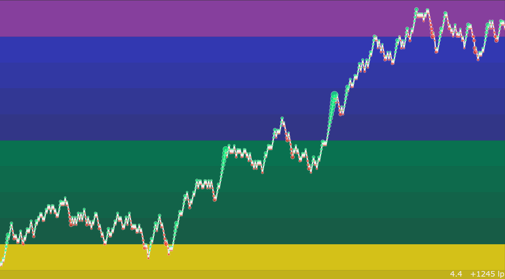

# Ranked Climb to Masters

A two-stage pipeline: `src/makeRequest.py` and `src/getMatchFiles.py` pull a
summoner's ranked solo-queue match history from the Riot Games API as raw
JSON, one file per game; `src/moveFiles.py` and `src/extractUsefulDataFromFiles.py`
distill each match down to one CSV row (champion, kills/deaths/assists,
win/loss, and the resulting League Points total). `src/main.py` chains
that CSV step and then hands off to `src/seabornPlot.py`'s animated line
plot — the climb from one rank to the next, shaded gold/emerald/platinum/diamond
by LP band — titled, in the code itself, "Ranked Climb to Masters!"

An earlier Plotly version (`plot.py`, unused by `main.py`) drew the same
bands as colored rectangles behind a static chart instead of an animated
line.

- [Features](features.md): the two halves — fetching data, then animating it.
- [Contributing](contributing.md): running the pipeline, its dependencies.
- [History](history.md): a 2023 data project, then two years of automated upkeep.
- [Trivia](trivia.md)

## Trivia

The repo's very first commit already carried nearly eight thousand raw
match files, one per League of Legends game, committed straight into git
rather than kept as a cache
([history](history.md#a-data-project-in-one-season-2023)).
